```{r setup, include=FALSE}
input_file <- knitr::current_input()
project_root <- normalizePath(
  file.path(dirname(input_file), ".."),
  mustWork = TRUE
)
knitr::opts_knit$set(root.dir = dirname(input_file))
options(width = 100)

required_packages <- c("knitr", "ggplot2", "cluster")
missing_packages <- required_packages[
  !vapply(required_packages, requireNamespace, logical(1), quietly = TRUE)
]
if (length(missing_packages) > 0) {
  stop(
    "Packages R manquants : ",
    paste(missing_packages, collapse = ", "),
    ". Installez-les avec install.packages()."
  )
}

data_path <- file.path(
  project_root,
  "data",
  "processed",
  "marketing_campaign_clean.csv"
)
if (!file.exists(data_path)) {
  stop(
    "Fichier préparé introuvable : ",
    data_path,
    ". Exécutez d'abord python src/02_clean_data.py."
  )
}

Sys.setenv(CUSTOMER_PERSONALITY_PROJECT_ROOT = project_root)
```

Ce rapport décrit les variables candidates à l’ACP, justifie le traitement
appliqué aux données, puis présente les segments obtenus. Les variables
`ID` et `Response` ne servent pas à construire les composantes ni les
segments. `Response` est uniquement décrite après segmentation.

## Préparation et diagnostic

Le diagnostic repère les valeurs manquantes et atypiques avant leur
prétraitement. Une valeur signalée par la règle IQR n’est pas nécessairement
une erreur ; elle n’est pas supprimée par ce diagnostic.

```{r diagnostic, echo=FALSE, results='hide', message=FALSE, warning=FALSE}
source(
  file.path(project_root, "R", "03_diagnose_pca_variables.R"),
  local = knitr::knit_global()
)
```

```{r diagnostic-results, echo=FALSE}
diagnostic <- read.csv(
  file.path(
    project_root,
    "reports",
    "segmentation",
    "diagnostic_valeurs_atypiques_iqr.csv"
  ),
  check.names = FALSE
)
knitr::kable(
  diagnostic,
  digits = 2,
  caption = "Valeurs atypiques détectées par la règle IQR"
)
```

Les âges supérieurs à 90 ans et le revenu égal à 666666 sont traités comme
manquants dans les variables d’analyse. Les valeurs manquantes sont imputées
par la médiane. Seules les six variables de dépenses sont plafonnées aux
percentiles 1 et 99 ; le revenu et les dépenses sont ensuite transformés avec
`log1p`. Toutes les variables utilisées sont centrées-réduites. Ces
opérations s’appliquent aux analyses, sans modifier le CSV préparé.

## Analyse en composantes principales

Le nombre de composantes retenu permet d’expliquer au moins 80 % de la
variance, dans la limite de dix composantes.

```{r pca-clustering, echo=FALSE, results='hide', message=FALSE, warning=FALSE}
source(
  file.path(project_root, "R", "04_pca_clustering.R"),
  local = knitr::knit_global()
)

segmentation_dir <- file.path(project_root, "reports", "segmentation")
figures_dir <- file.path(project_root, "figures", "segmentation")
```

```{r pca-variance, echo=FALSE}
variance <- read.csv(
  file.path(segmentation_dir, "variance_acp.csv"),
  check.names = FALSE
)
knitr::kable(
  head(variance, 10),
  digits = 2,
  caption = "Variance expliquée par les premières composantes"
)
```

Les variables suivantes ont une corrélation absolue d'au moins 0,30 avec
chaque composante retenue (trois variables au maximum). Le signe indique le
sens de l'association, sans établir de causalité.

```{r pca-interpretation, echo=FALSE}
component_interpretation <- read.csv(
  file.path(segmentation_dir, "interpretation_composantes_acp.csv"),
  check.names = FALSE
)
knitr::kable(
  component_interpretation,
  digits = 3,
  caption = "Variables les plus associées à chaque composante"
)
```

```{r pca-variance-figure, echo=FALSE, fig.cap="Variance individuelle et cumulée des composantes principales."}
if (!file.exists(file.path(figures_dir, "01_variance_acp.png"))) {
  stop(
    "Figure manquante. root=", project_root,
    "; figures_dir=", figures_dir,
    "; getwd=", getwd()
  )
}
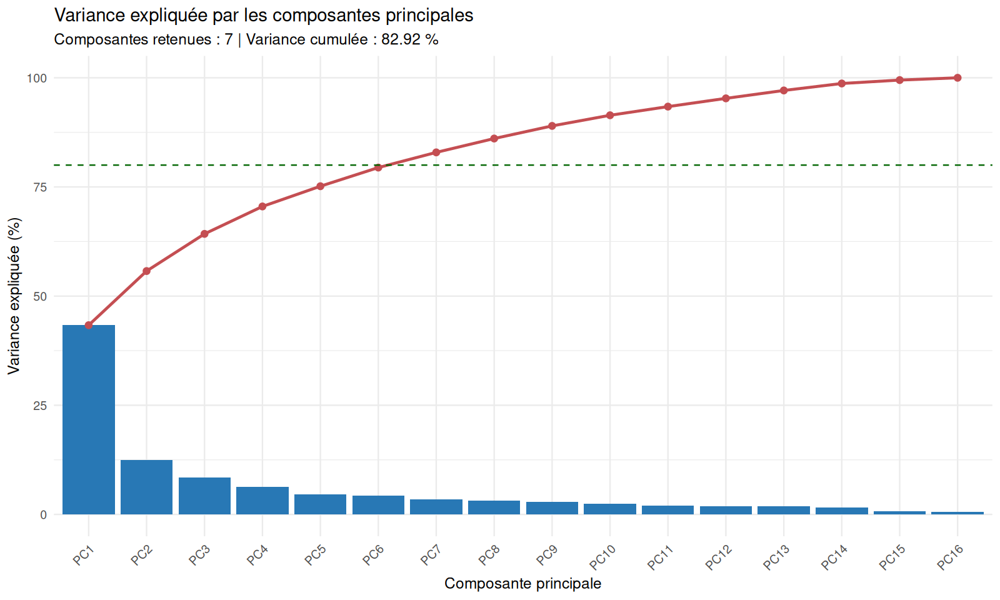
```

## Segmentation

Le nombre de segments est choisi en comparant la silhouette moyenne pour
plusieurs valeurs de `K`. La silhouette aide à comparer les partitions,
mais ne garantit pas à elle seule que les segments soient utiles au métier.

```{r cluster-selection, echo=FALSE}
selection <- read.csv(
  file.path(segmentation_dir, "selection_nombre_clusters.csv")
)
knitr::kable(
  selection,
  digits = 3,
  caption = "Silhouette moyenne selon le nombre de segments"
)
```

```{r cluster-selection-figure, echo=FALSE, fig.cap="Comparaison de la silhouette moyenne pour choisir le nombre de segments."}
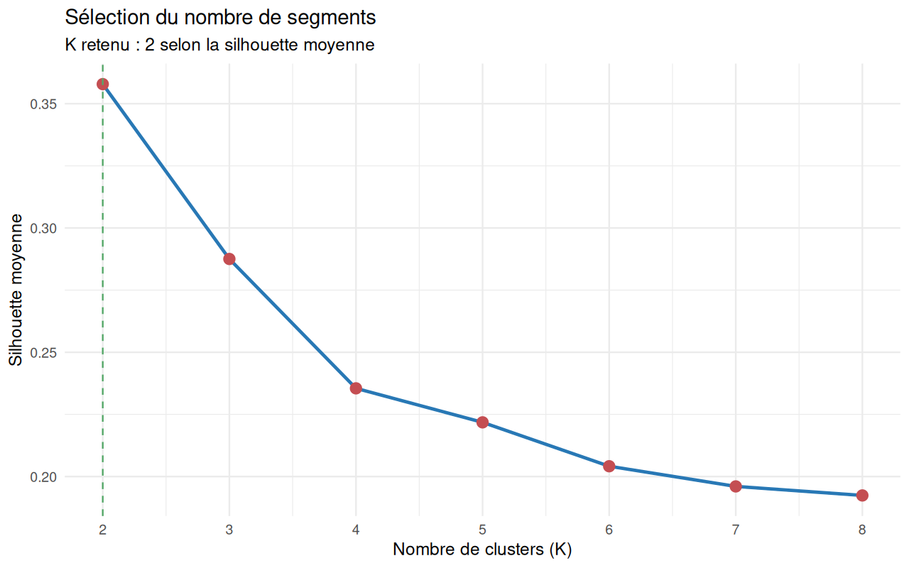
```

### Comparaison avec la classification ascendante hiérarchique

K-means et la CAH utilisent ici les mêmes clients, les mêmes composantes ACP
et la distance euclidienne. La CAH utilise le critère `Ward.D2`, puis son
arbre est coupé au même nombre de groupes que K-means. La silhouette compare
la cohésion et la séparation ; l'ARI compare la concordance des affectations
sans dépendre de la numérotation des groupes.

```{r method-comparison, echo=FALSE}
method_comparison <- read.csv(
  file.path(segmentation_dir, "comparaison_kmeans_cah.csv"),
  check.names = FALSE
)
knitr::kable(
  method_comparison,
  digits = 3,
  caption = "Comparaison des méthodes sur les mêmes données et avec le même K"
)
```

```{r method-silhouette-figure, echo=FALSE, fig.cap="Comparaison des silhouettes moyennes de K-means et de Ward.D2."}
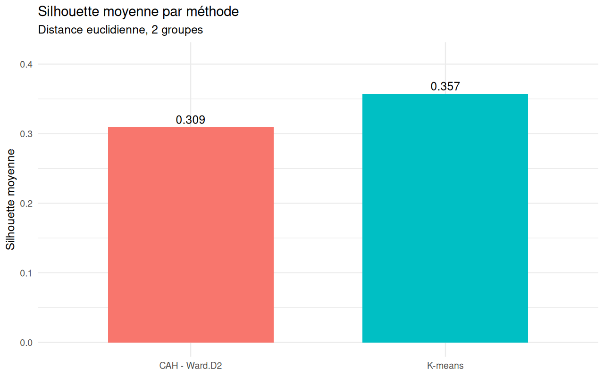
```

```{r kmeans-centroids-figure, echo=FALSE, fig.cap="K-means projeté sur PC1-PC2 ; les croix noires indiquent les centroïdes projetés et le titre donne la silhouette moyenne calculée sur toutes les composantes retenues."}
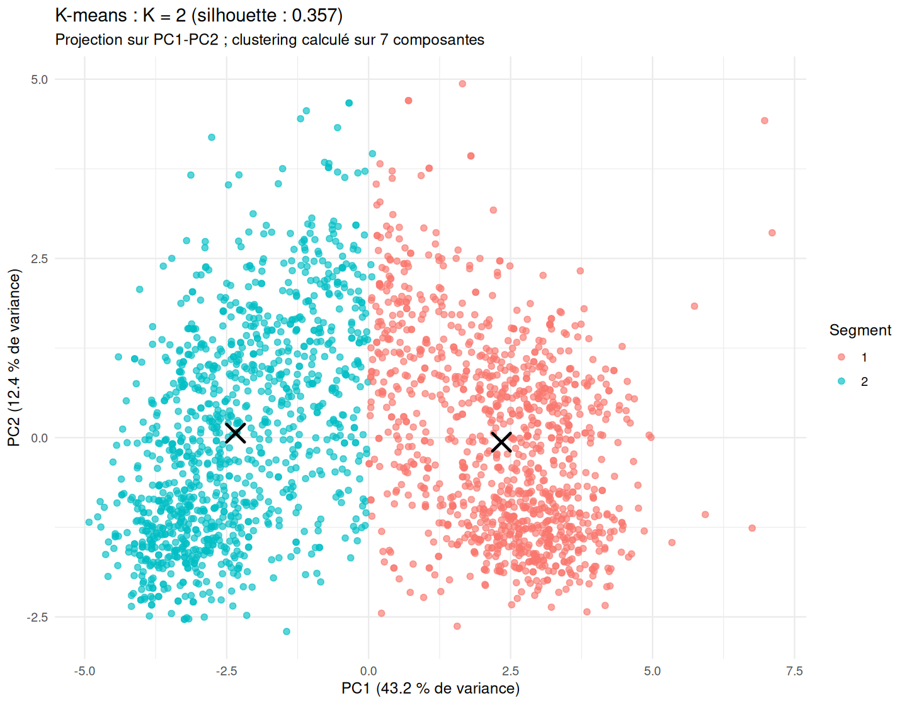
```

La silhouette moyenne est de
`r sprintf("%.3f", method_comparison$Silhouette_moyenne[method_comparison$Methode == "K-means"])`
pour K-means et de
`r sprintf("%.3f", method_comparison$Silhouette_moyenne[method_comparison$Methode == "CAH - Ward.D2"])`
pour Ward.D2. L'ARI entre les partitions est de
`r sprintf("%.3f", method_comparison$ARI_vs_Kmeans[method_comparison$Methode == "CAH - Ward.D2"])` ;
il décrit leur concordance, pas la qualité absolue d'une méthode.
Les numéros de groupes sont propres à chaque méthode ; les profils et les
affectations doivent être comparés, sans supposer que le groupe 1 correspond
au groupe 1 dans les deux partitions.

```{r method-cluster-sizes, echo=FALSE}
method_sizes <- read.csv(
  file.path(segmentation_dir, "tailles_segments_comparaison.csv"),
  check.names = FALSE
)
knitr::kable(
  method_sizes,
  digits = 2,
  caption = "Tailles et proportions des groupes selon la méthode"
)
```

```{r method-cluster-profiles, echo=FALSE}
method_profiles <- read.csv(
  file.path(segmentation_dir, "profils_kmeans_cah.csv"),
  check.names = FALSE
)
knitr::kable(
  method_profiles,
  digits = 2,
  caption = "Profils médians par groupe et par méthode"
)
```

```{r method-projection-figure, echo=FALSE, fig.cap="Projections des affectations K-means et Ward.D2 dans le plan des deux premières composantes."}
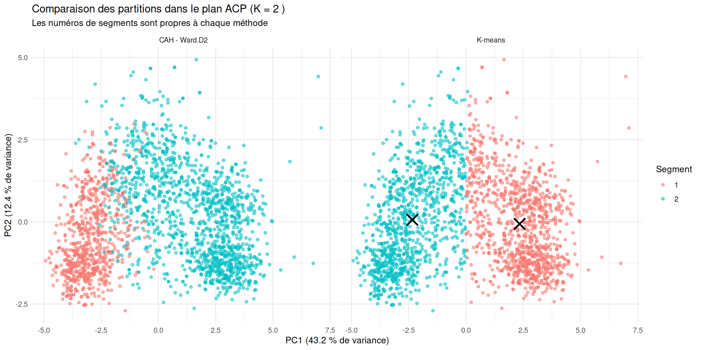
```

Le graphique des affectations montre aussi les centroïdes de K-means par une
croix noire. Ils ne sont pas affichés pour la CAH, qui est une méthode
hiérarchique sans centroïdes.

```{r ward-dendrogram-figure, echo=FALSE, fig.cap="Dendrogramme de Ward.D2 coupé au nombre de groupes retenu ; les étiquettes des clients sont masquées pour préserver la lisibilité."}
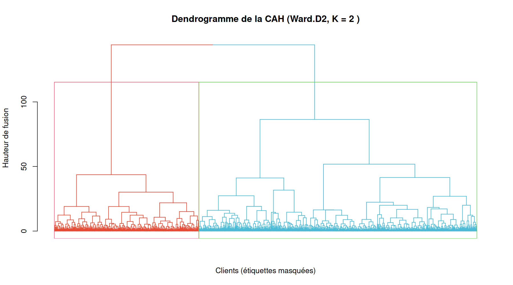
```

La CAH et la matrice des distances ont un coût mémoire et calcul de l'ordre
de `O(n²)`. Ce coût reste praticable pour les 2 240 clients étudiés, mais
augmente rapidement sur des jeux de données beaucoup plus grands.

```{r cluster-diagnostic-figure, echo=FALSE, fig.cap="Distribution des largeurs de silhouette dans la partition retenue."}
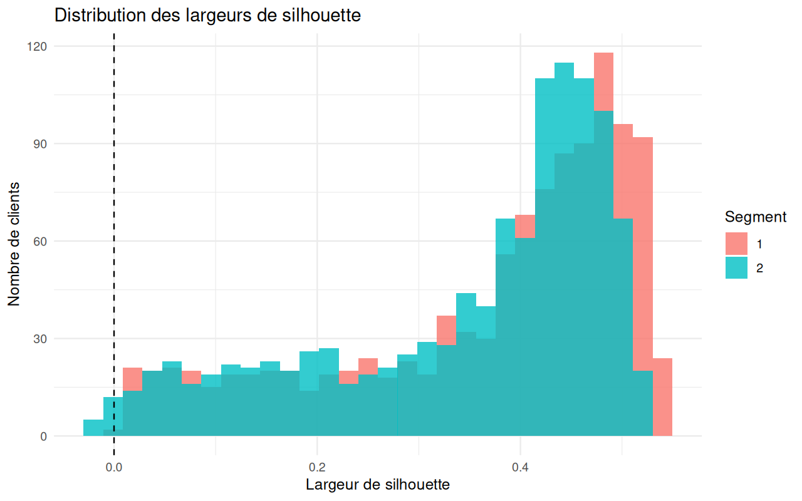
```

Le tableau ci-dessous décrit les silhouettes individuelles par segment :
quantiles, médiane et proportions de valeurs négatives ou proches de zéro.
Une silhouette négative signale une affectation à examiner, sans constituer
à elle seule la preuve d'une erreur de segmentation.

```{r silhouette-by-segment, echo=FALSE}
silhouette_by_segment <- read.csv(
  file.path(segmentation_dir, "diagnostic_silhouette_segments.csv"),
  check.names = FALSE
)
knitr::kable(
  silhouette_by_segment,
  digits = 3,
  caption = "Distribution des silhouettes individuelles par segment"
)
```

```{r individual-silhouette-figure, echo=FALSE, fig.cap="Silhouettes de chaque client, triées dans chaque segment. La ligne rouge marque zéro et la ligne orange le seuil exploratoire de 0,10."}
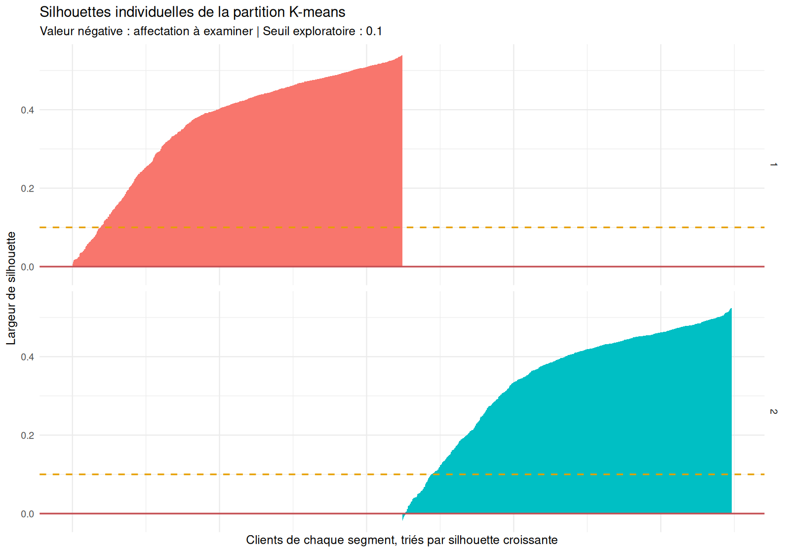
```

Des exports individuels sont générés localement pour examiner les silhouettes
et les clients proches de la frontière. Ils contiennent des identifiants et
des caractéristiques client et ne sont pas destinés à être publiés.

### Stabilité selon les initialisations de K-means

La partition retenue est comparée à 100 exécutions de K-means avec une
initialisation chacune. L'indice de Rand ajusté (ARI) est invariant à la
permutation des étiquettes : 1 correspond à des partitions identiques.

```{r cluster-stability, echo=FALSE}
stability <- read.csv(
  file.path(segmentation_dir, "resume_stabilite_kmeans.csv"),
  check.names = FALSE
)
knitr::kable(
  stability,
  digits = 3,
  caption = "Stabilité de la partition selon les initialisations"
)
```

Cette analyse mesure la sensibilité à l'initialisation sur les données et les
variables actuelles ; elle ne mesure pas la stabilité sur de nouveaux
échantillons.

### Stabilité par sous-échantillonnage

K-means est réajusté sur 100 sous-échantillons sans remise contenant 80 % des
clients, avec 50 initialisations par ajustement. Chaque modèle est utilisé
pour affecter tous les clients au centroïde le plus proche ; ces affectations
sont comparées à la partition de référence par ARI.

```{r cluster-subsampling-stability, echo=FALSE}
subsample_stability <- read.csv(
  file.path(
    segmentation_dir,
    "resume_stabilite_sous_echantillonnage.csv"
  ),
  check.names = FALSE
)
knitr::kable(
  subsample_stability,
  digits = 3,
  caption = "Stabilité de K-means après sous-échantillonnage des clients"
)
```

Cette analyse conserve fixes le prétraitement et l'ACP calculés sur l'ensemble
des clients. Elle évalue donc la sensibilité de K-means à la composition de
l'échantillon dans cet espace ACP, et non la stabilité de toute la chaîne de
traitement ou sa généralisation à une nouvelle population.

### Validation sur un échantillon mis de côté

Une validation complémentaire réserve 20 % des clients avant le
prétraitement. Les médianes d'imputation, seuils de plafonnement,
paramètres de standardisation, ACP, nombre de groupes et centroïdes sont
estimés uniquement sur les 80 % d'entraînement. Le test est transformé avec
ces paramètres, puis affecté aux centroïdes appris sans réajuster le modèle.

```{r holdout-validation, echo=FALSE}
holdout <- read.csv(
  file.path(segmentation_dir, "validation_echantillon_mis_de_cote.csv"),
  check.names = FALSE
)
knitr::kable(
  holdout,
  digits = 3,
  caption = "Silhouette sur l'entraînement et le test mis de côté"
)

holdout_profiles <- read.csv(
  file.path(segmentation_dir, "profils_segments_test_independant.csv"),
  check.names = FALSE
)
knitr::kable(
  holdout_profiles,
  digits = 2,
  caption = "Profils observés dans le test, par centroïde appris sur l'entraînement"
)
```

Le test est une partie mise de côté du même jeu de données : il évalue la
reproductibilité sur des clients non utilisés pour ajuster ce modèle, mais
ne remplace pas une validation externe sur une autre période ou population.
Les affectations individuelles du test sont exportées dans
`affectations_test_independant.csv`.

La silhouette de validation est calculée à partir des distances entre les
clients du test uniquement, avec leurs affectations fixées par les centroïdes
appris sur l'entraînement. Elle ne représente donc pas une distance entre
chaque client du test et l'ensemble des clients d'entraînement.

### Clients proches de la frontière

Une silhouette inférieure ou égale à 0,10 sert ici de seuil exploratoire
pour repérer les affectations proches de la frontière ; ce seuil n'est pas
une règle universelle. Les silhouettes négatives indiquent que les clients
sont, selon cette mesure, plus proches d'un autre groupe. Les chiffres de
cette section et la figure des silhouettes individuelles concernent la
segmentation initiale de l'ensemble des clients, et non le sous-échantillon
de test de la validation 80/20.

```{r boundary-summary, echo=FALSE}
boundary_summary <- read.csv(
  file.path(segmentation_dir, "resume_clients_proches_frontiere.csv"),
  check.names = FALSE
)
knitr::kable(
  boundary_summary,
  digits = 2,
  caption = "Résumé des silhouettes proches de zéro ou négatives"
)
```

Dans cette partition, **`r boundary_summary$Nombre_clients_proches_frontiere[[1]]`
clients (`r sprintf("%.2f", boundary_summary$Pourcentage_clients_proches_frontiere[[1]])` %)
ont une silhouette inférieure ou égale à 0,10**, et
**`r boundary_summary$Nombre_silhouettes_negatives[[1]]`
(`r sprintf("%.2f", boundary_summary$Pourcentage_silhouettes_negatives[[1]])` %)
ont une silhouette négative**. Ces derniers sont à examiner en priorité.
Le seuil de 0,10 est exploratoire : il aide à sélectionner des cas, mais ne
constitue pas une frontière statistique universelle.

```{r cluster-map, echo=FALSE, fig.cap="Clients représentés sur les deux premières composantes, colorés par segment."}
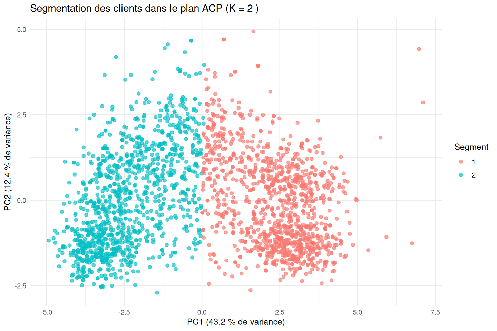
```

```{r cluster-sizes, echo=FALSE}
sizes <- read.csv(
  file.path(segmentation_dir, "tailles_segments.csv")
)
knitr::kable(
  sizes,
  digits = 1,
  caption = "Taille des segments"
)
```

```{r cluster-profiles-figure, echo=FALSE, fig.cap="Profil relatif des variables dans chaque segment."}
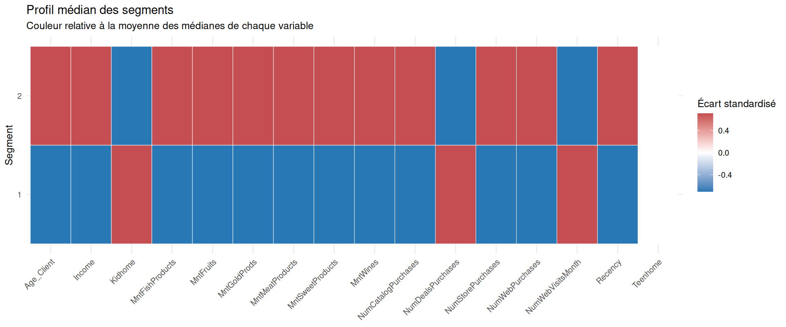
```

```{r cluster-profiles, echo=FALSE}
profiles <- read.csv(
  file.path(segmentation_dir, "profils_segments.csv"),
  check.names = FALSE
)
knitr::kable(
  profiles,
  digits = 2,
  caption = "Profils médians sur les variables d'origine et taux de réponse observé"
)
```

## Distributions et comparaison descriptive des segments

Les descriptifs neutralisent, sans modifier les données originales, les âges
supérieurs à 90 ans et le revenu égal à 666666. Les variables numériques sont
résumées par segment avec moyenne, écart-type, médiane, quartiles et
pourcentage de zéros. Les boîtes à moustaches et les fonctions de répartition
empirique complètent les médianes afin de montrer la dispersion et
l'asymétrie.

```{r quantitative-distributions, echo=FALSE}
quantitative_distributions <- read.csv(
  file.path(
    segmentation_dir,
    "distributions_quantitatives_segments.csv"
  ),
  check.names = FALSE
)
knitr::kable(
  quantitative_distributions,
  digits = 2,
  caption = "Statistiques descriptives des variables quantitatives par segment"
)
```

```{r quantitative-boxplots, echo=FALSE, fig.cap="Boîtes à moustaches par segment ; les échelles verticales sont propres à chaque variable."}
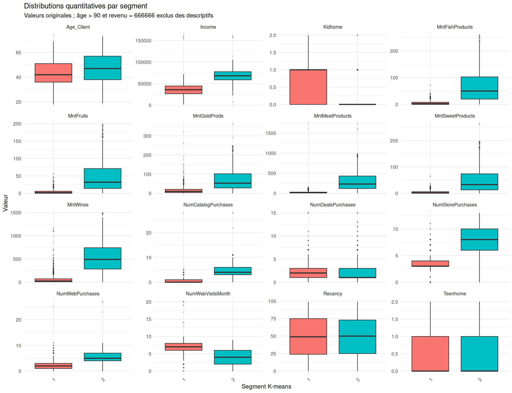
```

```{r quantitative-ecdf, echo=FALSE, fig.cap="Fonctions de répartition empirique des variables quantitatives par segment."}
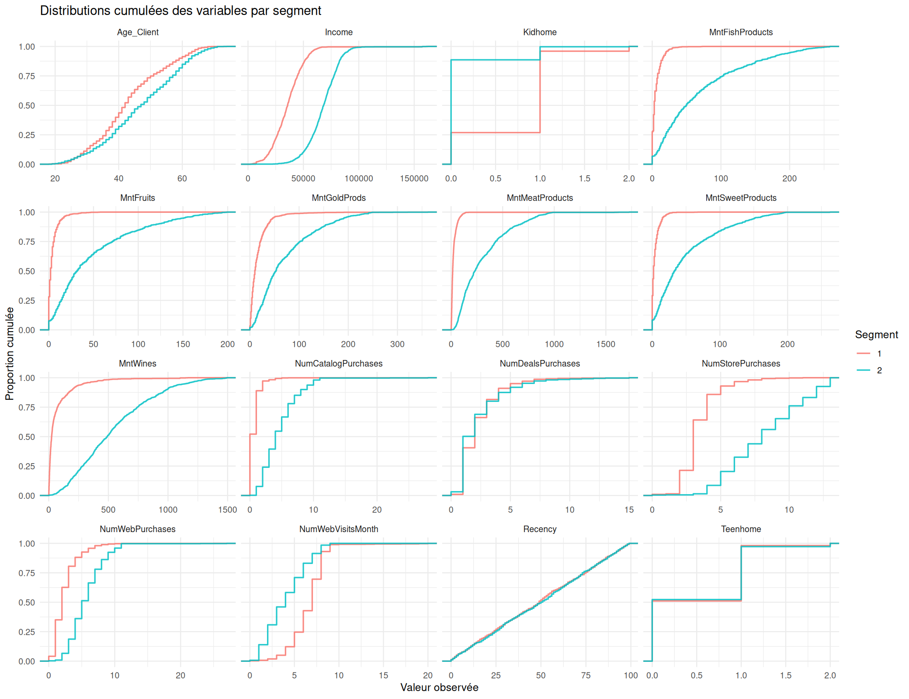
```

Pour les variables quantitatives, le test de Wilcoxon-Mann-Whitney compare
les rangs des deux groupes et le delta de rangs de Cliff donne une mesure
d'effet. Pour la réponse, le niveau d'éducation et le statut matrimonial,
les distributions sont comparées par chi-deux ; une p-value simulée est
utilisée si les effectifs théoriques sont faibles. Les p-values sont
corrigées par la méthode de Holm sur l'ensemble des comparaisons.
Les tailles d'effet numériques sont orientées « segment 1 versus segment 2 » :
un delta négatif indique des valeurs généralement plus élevées dans le
segment 2. Les p-values plus petites que la précision numérique disponible
sont enregistrées à la limite machine et ne doivent pas être interprétées
comme exactement nulles.

Ces tests restent exploratoires et descriptifs : les variables quantitatives
ont participé à la construction de K-means, de sorte que leurs écarts ne
constituent pas une validation indépendante des segments. Les p-values ne
démontrent ni causalité ni utilité marketing.

```{r distribution-tests, echo=FALSE}
distribution_tests <- read.csv(
  file.path(segmentation_dir, "tests_differences_segments.csv"),
  check.names = FALSE
)
distribution_tests$P_value <- format.pval(
  distribution_tests$P_value,
  digits = 3,
  eps = 1e-4
)
distribution_tests$P_value_Holm <- format.pval(
  distribution_tests$P_value_Holm,
  digits = 3,
  eps = 1e-4
)
knitr::kable(
  distribution_tests,
  digits = 4,
  caption = "Comparaisons exploratoires entre segments et tailles d'effet"
)

categorical_distributions <- read.csv(
  file.path(
    segmentation_dir,
    "distributions_categorielles_segments.csv"
  ),
  check.names = FALSE
)
recommendations <- read.csv(
  file.path(segmentation_dir, "recommandations_marketing.csv"),
  check.names = FALSE
)
knitr::kable(
  categorical_distributions,
  digits = 2,
  caption = "Effectifs et pourcentages des modalités par segment"
)

format_segment_median <- function(variable, cluster) {
  value <- quantitative_distributions$Mediane[
    quantitative_distributions$Variable == variable &
      quantitative_distributions$Segment == cluster
  ]
  format(
    round(value[[1]], 2),
    big.mark = " ",
    decimal.mark = ",",
    trim = TRUE
  )
}
response_yes_pct <- categorical_distributions$Pourcentage_segment[
  categorical_distributions$Variable == "Response" &
    categorical_distributions$Modalite == "1"
]
```

Dans les données analysées, le segment 2 présente un revenu médian de
`r format_segment_median("Income", "2")` contre
`r format_segment_median("Income", "1")` pour le segment 1 ; les dépenses
médianes en vin sont respectivement de
`r format_segment_median("MntWines", "2")` et
`r format_segment_median("MntWines", "1")`. Le segment 2 achète aussi plus
souvent en magasin (médianes :
`r format_segment_median("NumStorePurchases", "2")` contre
`r format_segment_median("NumStorePurchases", "1")`), tandis que les visites
web mensuelles médianes sont
`r format_segment_median("NumWebVisitsMonth", "2")` contre
`r format_segment_median("NumWebVisitsMonth", "1")`. La récence médiane est
proche (`r format_segment_median("Recency", "1")` contre
`r format_segment_median("Recency", "2")` jours). Le taux descriptif de
réponse à une campagne est de
`r sprintf("%.2f", response_yes_pct[[1]])` % dans le segment 1 et
`r sprintf("%.2f", response_yes_pct[[2]])` % dans le segment 2. Ces écarts
décrivent les groupes sur cet échantillon ; ils n'impliquent pas de causalité.

## Interprétation métier des segments

### Résultats statistiques observés

Le segment 1 comprend **`r profiles$Nombre_clients[profiles$Segment == 1]`
clients (`r sprintf("%.2f", profiles$Nombre_clients[profiles$Segment == 1] / sum(profiles$Nombre_clients) * 100)` %)**.
Sa dépense totale médiane est de **`r format(recommendations$Depenses_totales_medianes[recommendations$Segment == 1], big.mark = " ", decimal.mark = ",")`**,
inférieure à la médiane globale de **`r format(recommendations$Depenses_totales_medianes_population[recommendations$Segment == 1], big.mark = " ", decimal.mark = ",")`**.
Son revenu médian est de **`r format_segment_median("Income", "1")`**.
Les médianes d'achats sont de **`r format_segment_median("NumStorePurchases", "1")`** en magasin,
**`r format_segment_median("NumWebPurchases", "1")`** sur le Web et
**`r format_segment_median("NumCatalogPurchases", "1")`** par catalogue.
Le taux de réponse observé est de **`r sprintf("%.2f", response_yes_pct[[1]])` %**.

Le segment 2 comprend **`r profiles$Nombre_clients[profiles$Segment == 2]`
clients (`r sprintf("%.2f", profiles$Nombre_clients[profiles$Segment == 2] / sum(profiles$Nombre_clients) * 100)` %)**.
Sa dépense totale médiane est de **`r format(recommendations$Depenses_totales_medianes[recommendations$Segment == 2], big.mark = " ", decimal.mark = ",")`**,
au-dessus de la médiane globale de **`r format(recommendations$Depenses_totales_medianes_population[recommendations$Segment == 2], big.mark = " ", decimal.mark = ",")`**.
Son revenu médian est de **`r format_segment_median("Income", "2")`**.
Les médianes d'achats sont de **`r format_segment_median("NumStorePurchases", "2")`** en magasin,
**`r format_segment_median("NumWebPurchases", "2")`** sur le Web et
**`r format_segment_median("NumCatalogPurchases", "2")`** par catalogue.
Le taux de réponse observé est de **`r sprintf("%.2f", response_yes_pct[[2]])` %**.

### Lecture métier prudente

Dans les données étudiées, le segment 1 présente une intensité d'achat et
des dépenses plus faibles. Le segment 2 rassemble des clients aux dépenses,
revenus médians et fréquences d'achat observés plus élevés. Les différences
de taux de réponse sont descriptives et ne démontrent pas que l'appartenance
à un segment cause une réponse plus élevée. Il s'agit de profils observés,
pas d'une valeur vie client ni d'une prévision de comportement futur.

Le canal « Magasin » désigne le canal dont le **nombre médian d'achats**
est le plus élevé dans chaque segment. Cela ne signifie ni que ce canal
représente la majorité des dépenses, ni qu'il génère la majorité du chiffre
d'affaires.

### Recommandations à tester

- **Segment 1 :** expérimenter une offre de découverte, une promotion ciblée
  ou une action de vente croisée, avec plusieurs messages à comparer.
- **Segment 2 :** tester une action de fidélisation, une offre premium ou
  des produits complémentaires.
- Dans les deux cas, adapter le pilote au canal magasin, où la médiane du
  nombre d'achats est la plus élevée, sans en déduire une répartition des
  dépenses par canal.
- Mesurer les résultats à l'aide d'un groupe témoin et d'indicateurs définis
  à l'avance (conversion, chiffre d'affaires incrémental et rentabilité).

Ces actions sont des hypothèses opérationnelles. Leur efficacité doit être
mesurée par des campagnes contrôlées avant tout déploiement.

```{r categorical-distributions-figure, echo=FALSE, fig.cap="Répartition de la réponse, de l'éducation et du statut matrimonial dans chaque segment."}
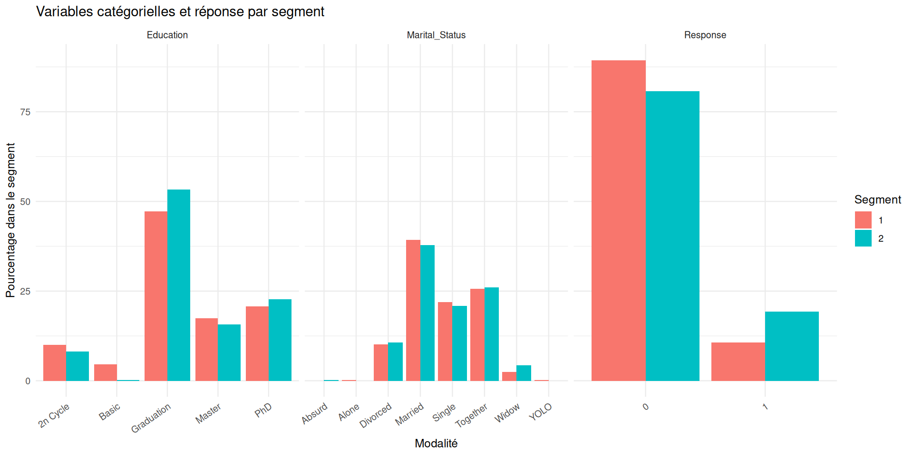
```

## Recommandations marketing à tester

Les pistes ci-dessous sont générées à partir des dépenses totales médianes,
du canal d'achat médian le plus utilisé et du taux de réponse observé dans
chaque segment, comparés aux valeurs globales. Elles servent à formuler des
hypothèses de ciblage ; elles ne démontrent ni causalité ni efficacité future.

```{r marketing-recommendations, echo=FALSE}
recommendations <- read.csv(
  file.path(segmentation_dir, "recommandations_marketing.csv"),
  check.names = FALSE
)
knitr::kable(
  recommendations,
  digits = 2,
  caption = "Pistes marketing fondées sur les profils observés"
)
```

## Interprétation et limites

- Les segments sont des profils exploratoires, pas des catégories naturelles
  garanties ni des groupes causaux.
- Les données manquantes et valeurs extrêmes sont traitées uniquement pour
  l’ACP et le clustering ; les exports de profils utilisent les données
  d’origine.
- La réponse aux campagnes n’a pas influencé la création des segments. Son
  taux par groupe est descriptif et ne prouve pas une différence causale.
- Le choix final des segments doit aussi tenir compte de leur taille, de leur
  stabilité et de leur interprétabilité commerciale.
- Le diagnostic de stabilité compare les initialisations sur le même jeu de
  données ; il ne remplace pas une validation sur des échantillons distincts.
- Le sous-échantillonnage teste la sensibilité à la composition des clients,
  conditionnellement au prétraitement et à l'ACP déjà calculés sur l'ensemble.
