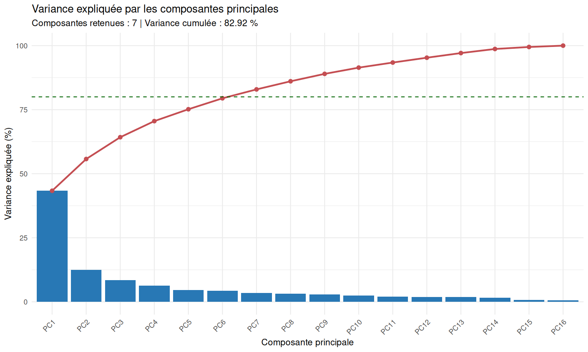
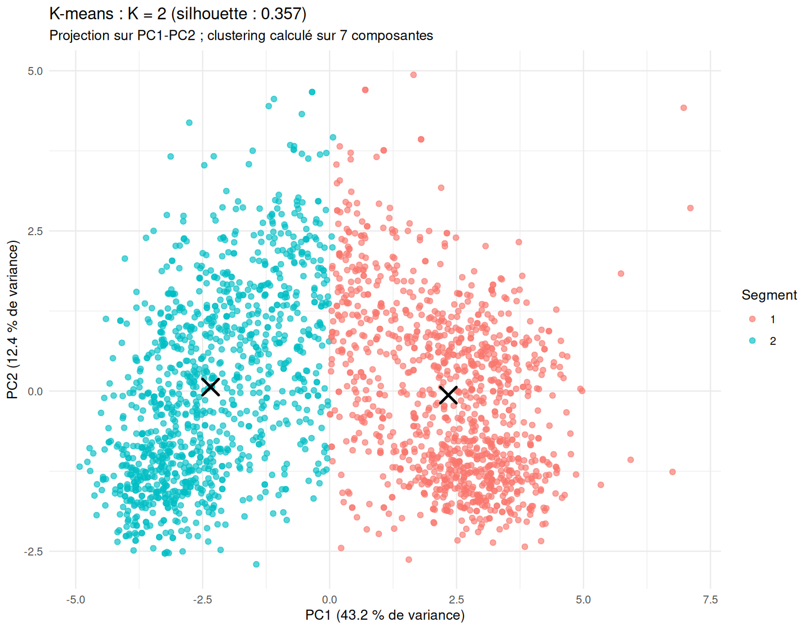
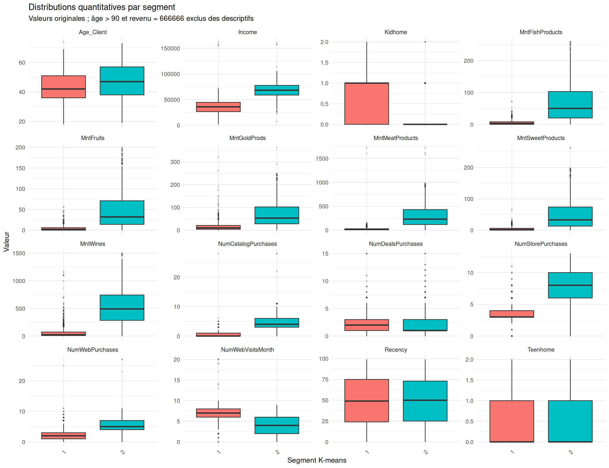
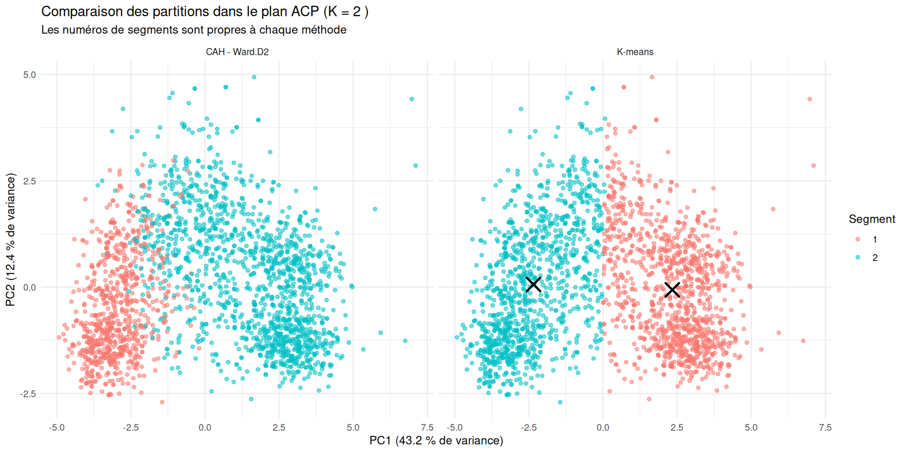

# Customer Personality Analysis

## Description

Customer Personality Analysis est un projet de Data Science visant à analyser
le comportement des clients et à identifier des segments homogènes à partir
de leurs caractéristiques sociodémographiques, de leurs revenus, de leurs
dépenses et de leurs habitudes d'achat.

À partir d'un jeu de données marketing de 2 240 clients, le projet suit une
démarche complète d'analyse de données : inspection, nettoyage, analyse
exploratoire, réduction de dimension par Analyse en Composantes Principales
(ACP) et segmentation par l'algorithme K-means.

L'objectif est de mieux comprendre les différents profils de consommateurs,
d'identifier leurs comportements d'achat et de fournir des éléments d'aide à
la décision pour améliorer le ciblage des campagnes marketing.

## Objectifs

- Explorer et comprendre les données clients.
- Assurer la qualité et la cohérence des données.
- Analyser les caractéristiques et comportements des consommateurs.
- Réduire la dimension des données à l'aide de l'ACP.
- Segmenter les clients avec K-means.
- Interpréter les groupes obtenus et formuler des recommandations marketing.

## Technologies

- Python : Pandas, NumPy, Matplotlib, Seaborn, SciPy.
- R : `prcomp` (ACP), `ggplot2` et `cluster` (K-means et silhouettes),
  `rmarkdown` et `knitr` (rapport).
- Git et GitHub : versionnement et documentation.

## Résultats clés

L'analyse porte sur **2 240 clients**. Après préparation de 16 variables
numériques, les sept premières composantes principales expliquent **82,81 %**
de la variance. Le nombre de groupes retenu par silhouette est **K = 2**.

| Indicateur | Résultat observé |
|---|---:|
| Silhouette moyenne K-means | 0,357 (séparation modérée) |
| Silhouette moyenne Ward.D2 | 0,309 |
| ARI entre les partitions K-means et Ward | 0,469 |
| ARI moyen, 100 initialisations K-means | 0,992 |
| ARI moyen, 100 sous-échantillons de 80 % | 0,979 |
| Silhouette du test mis de côté (20 %) | 0,377 |
| Clients de la partition initiale avec silhouette ≤ 0,10 | 194 (8,66 %) |

Le test 80/20 ajuste l'imputation, le plafonnement, la standardisation,
l'ACP et K-means sur les 80 % d'entraînement uniquement. Sa silhouette est
calculée entre les clients du test après affectation aux centroïdes appris ;
elle ne mesure pas leur distance à tous les clients d'entraînement. Le test
provient du même jeu de données et ne constitue pas une validation externe.
La stabilité par sous-échantillonnage maintient, elle, le prétraitement et
l'ACP calculés sur l'ensemble des clients.

Les profils sont descriptifs : le segment 1 présente un revenu médian de
35 765 et des dépenses totales médianes de 69 ; pour le segment 2, ces
médianes sont respectivement de 68 211 et 1 034. Le taux de réponse observé
est de 10,62 % et 19,21 %. Ces constats ne démontrent pas de causalité,
d'efficacité marketing ou de comportement futur.

## Figures sélectionnées

### ACP — variance expliquée



### K-means — projection des clients et centroïdes



### Comparaison des distributions par segment



### Comparaison K-means et Ward.D2



## Données et méthodologie

Le fichier brut local contient 2 240 clients et 29 colonnes, avec des champs
séparés par tabulation. Le nettoyage Python produit un fichier préparé de
2 240 lignes et 31 colonnes ; l'analyse exploratoire y relève 24 revenus
manquants et aucun doublon exact. Les fichiers de données sont exclus de Git.
La provenance exacte et la licence restent à confirmer (voir
[`docs/data_sources.md`](docs/data_sources.md)).

Le pipeline :

1. Inspecte et prépare les données, puis produit une analyse exploratoire.
2. Exclut `ID`, `Response` et les variables catégorielles de la construction
   des segments ; `Response` sert uniquement à décrire les groupes ensuite.
3. Pour l'ACP et K-means, traite les âges supérieurs à 90 et le revenu égal à
   666666 comme manquants, impute par médiane, plafonne les six variables de
   dépenses aux percentiles 1 et 99, applique `log1p` au revenu et aux
   dépenses, puis centre-réduit les 16 variables numériques.
4. Retient assez de composantes pour expliquer au moins 80 % de la variance
   (maximum 10), choisit K entre 2 et 8 selon la silhouette et compare
   K-means à Ward.D2.
5. Évalue les silhouettes, la stabilité, les profils et une validation
   interne 80/20 où le prétraitement, l'ACP et K-means sont ajustés sur
   l'entraînement uniquement.

Les traitements spécifiques à l'ACP ne modifient pas le CSV préparé.
Consulter le rapport pour les détails, paramètres et sorties complets.

## Structure
- `data/raw/` : fichiers originaux, non modifiés (non suivis par Git).
- `data/processed/` : données préparées (non suivies par Git).
- `src/` : scripts Python d'inspection, de nettoyage et d'analyse.
- `figures/eda/` : graphiques de l'analyse exploratoire.
- `figures/segmentation/` : diagnostics de l'ACP et des segments.
- `reports/eda/` : synthèses et rapports de l'analyse exploratoire.
- `reports/segmentation/` : profils et résultats de l'ACP/segmentation.
- `notebooks/` : analyses exploratoires complémentaires.
- `R/` : scripts R.
- `docs/` : dictionnaire de données et décisions méthodologiques.

## Démarrage
Voir `docs/INSTALLATION.md`.

Le [rapport complet en Markdown](reports/segmentation/pca_segmentation.md)
est consultable directement sur GitHub. Le [rapport HTML](reports/segmentation/pca_segmentation.html)
est généré localement par le pipeline ; télécharge-le puis ouvre-le dans un
navigateur pour consulter sa version avec les figures intégrées.

## Exécuter tout le projet

Après avoir installé les dépendances Python et R et placé
`marketing_campaign.csv` dans `data/raw/`, exécuter depuis le dossier du
projet :

```bash
./run_all.sh
```

Le script enchaîne l'inspection des données brutes, leur nettoyage,
l'analyse exploratoire Python, puis le diagnostic des variables, l'ACP,
la segmentation et le rendu du rapport R. Il s'arrête dès qu'une étape
échoue. Les principaux rapports sont générés dans `reports/eda/` et
`reports/segmentation/`.

## Rapports et sorties

- [Rapport EDA](reports/eda/eda_summary.md) : qualité des données,
  statistiques descriptives, corrélations et comportement de réponse.
- [Rapport ACP et segmentation](reports/segmentation/pca_segmentation.md) :
  méthodologie complète, diagnostics, stabilité, comparaison des méthodes,
  distributions et interprétation métier.
- Le rapport [HTML](reports/segmentation/pca_segmentation.html) est généré
  par `./run_all.sh`; télécharger le fichier et l'ouvrir dans un navigateur
  pour consulter les figures intégrées.
- Les fichiers CSV détaillés se trouvent sous `reports/eda/tables/` et
  `reports/segmentation/`.

### Interprétation métier (descriptive)

Sur les données étudiées, K-means distingue deux profils :

- **Segment 1 — intensité d'achat plus faible** : 1 121 clients (50,04 %),
  revenu médian de 35 765, dépenses totales médianes de 69 contre 396 pour
  l'ensemble, et taux de réponse observé de 10,62 %. Les médianes d'achats
  sont de 3 en magasin, 2 sur le Web et 0 par catalogue.
- **Segment 2 — intensité d'achat et dépenses plus élevées** : 1 119 clients
  (49,96 %), revenu médian de 68 211, dépenses totales médianes de 1 034 et
  taux de réponse observé de 19,21 %. Les médianes d'achats sont de 8 en
  magasin, 5 sur le Web et 4 par catalogue.

Ces profils décrivent l'échantillon ; ils ne démontrent ni causalité, ni
valeur vie client, ni comportement futur. « Magasin » est le canal dont la
médiane du nombre d'achats est la plus élevée dans les deux segments. Cela
ne signifie pas qu'il représente la majorité des dépenses. Les pistes
marketing (découverte/vente croisée pour le segment 1 ; fidélisation/offres
premium pour le segment 2) sont des hypothèses à évaluer par des campagnes
pilotes contrôlées, avec un groupe témoin et des indicateurs de résultat
définis à l'avance.

## État de la validation

| Étape | État |
|---|---|
| Inspection, préparation et analyse exploratoire | Réalisées |
| Diagnostic des variables et ACP | Réalisés |
| Segmentation K-means et évaluation par silhouette | Réalisées |
| Stabilité aux initialisations | Réalisée |
| Sensibilité à la composition par sous-échantillonnage | Réalisée, conditionnellement au prétraitement et à l'ACP actuels |
| Comparaison K-means / CAH de Ward | Réalisée sur les mêmes scores d'ACP |
| Validation interne sur un test mis de côté, prétraitement/ACP ajustés sur l'entraînement | Réalisée |
| Validation externe sur une autre période ou population | À réaliser |

## Reproductibilité
Les fichiers de données ne sont pas inclus dans Git. La provenance exacte,
la licence et la date de téléchargement restent à confirmer ; les dimensions
et empreintes locales vérifiées sont consignées dans
[`docs/data_sources.md`](docs/data_sources.md). Ne republie pas le jeu de
données avant d'avoir vérifié les conditions de sa source.
